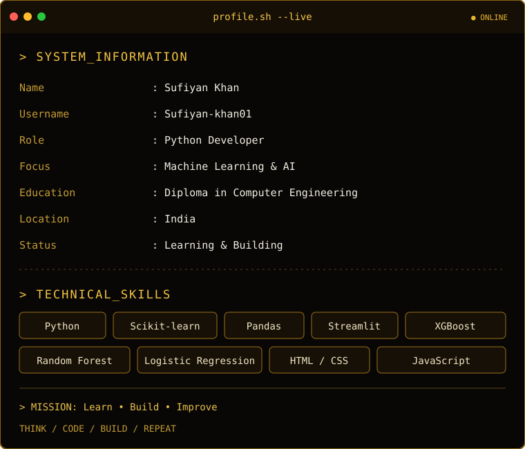

  

<table>
<tr>
<td width="38%" align="center" valign="middle">
  
    
  <h2>SUFIYAN KHAN</h2>
  <code>PYTHON DEVELOPER</code>
   
  Dream Big. Code Better. Build Greater.
</td>
<td width="62%" valign="middle">
  
</td>
</tr>
</table>

---

## `01 / SYSTEM_SKILLS`

  

  
  
  
  

## `02 / FEATURED_PROJECTS`

| Project | Technology |
|---|---|
| Credit Card Fraud Detection | Python, Logistic Regression |
| Email Spam Detection | Python, NLP |
| House Price Prediction | Python, Linear Regression |
| Customer Churn Prediction | Machine Learning |
| AQI Prediction | Python, XGBoost |
| Crop Yield Prediction | Python, Random Forest |
| Customer Segmentation | Python, K-Means |

## `03 / GITHUB_STATISTICS`

  
  

  

## `04 / CONTRIBUTION_GRAPH`

  

## `05 / CONTRIBUTION_SNAKE`

  <picture>
    <source media="(prefers-color-scheme: dark)" srcset="https://raw.githubusercontent.com/Sufiyan-khan01/Sufiyan-khan01/output/snake-dark.svg"/>
    <source media="(prefers-color-scheme: light)" srcset="https://raw.githubusercontent.com/Sufiyan-khan01/Sufiyan-khan01/output/snake-light.svg"/>
    
  </picture>

---

  <code>&gt; while(alive) { learn(); build(); improve(); }</code>

  <b>⚡ THINK • CODE • BUILD • REPEAT ⚡</b>

  
  

