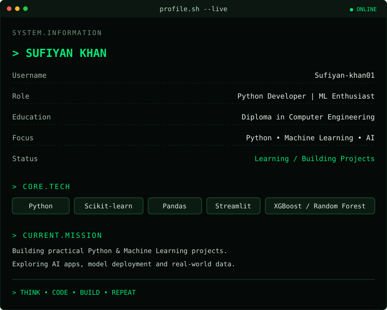

<table>
<tr>
<td width="38%" align="center" valign="top">
  
   
  <b>SUFIYAN KHAN</b> 
  <code>PYTHON DEVELOPER</code>
</td>
<td width="62%" valign="top">
  
</td>
</tr>
</table>

  

---

## `01 / ABOUT_ME`

- 🎓 Diploma student in **Computer Engineering**
- 🐍 Interested in **Python development and Machine Learning**
- 🤖 Building practical projects using ML algorithms and data science tools
- 🚀 Exploring model deployment with **Streamlit**
- 🌱 Continuously learning and improving through hands-on projects

## `02 / TECH_STACK`

  

  
  
  
  

## `03 / FEATURED_PROJECTS`

| Project | Tools / Concepts |
|---|---|
| Credit Card Fraud Detection | Python, Logistic Regression |
| Email Spam Detection | Python, NLP, Classification |
| House Price Prediction | Python, Linear Regression |
| Customer Churn Prediction | Machine Learning |
| AQI Prediction | Python, XGBoost |
| Crop Yield Prediction | Python, Random Forest |
| Customer Segmentation | Python, K-Means |

> Visit the repositories tab to explore project code and implementation details.

## `04 / GITHUB_STATS`

  
  

  

## `05 / CONTRIBUTION_ACTIVITY`

  

## `06 / CONTRIBUTION_SNAKE`

  <picture>
    <source media="(prefers-color-scheme: dark)" srcset="https://raw.githubusercontent.com/Sufiyan-khan01/Sufiyan-khan01/output/snake-dark.svg"/>
    <source media="(prefers-color-scheme: light)" srcset="https://raw.githubusercontent.com/Sufiyan-khan01/Sufiyan-khan01/output/snake-light.svg"/>
    
  </picture>

---

## `07 / CONNECT`

  

<code>while(alive) { learn(); build(); improve(); }</code>

<b>⚡ THINK • CODE • BUILD • REPEAT ⚡</b>

